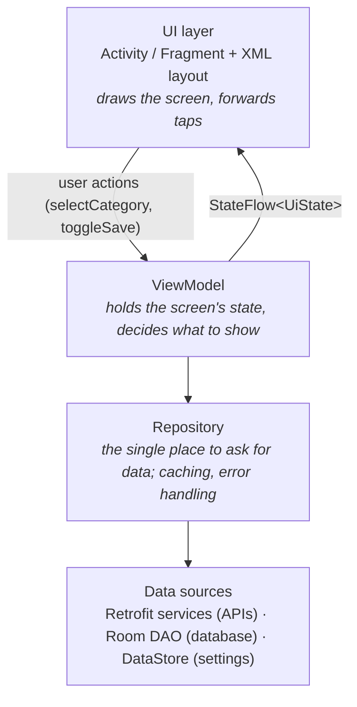

# FOMO project guide

A map of the codebase, written so that you can open any file, point at any line, and say what it is for.
Read it in order once, then use it as a reference.

---

## 1. The big picture: four layers

Every feature in FOMO is split into the same four layers. Each layer only talks to the one directly below it.

**Why split it like this?** Each layer has one job, so a change in one place does not ripple everywhere.

- **The screen can be replaced without touching data code.** For example, switching XML to Compose one day.
- **The events API can be replaced without touching any screen.** This actually happened: Ticketmaster → Data Thistle changed the data layer only.
- **Logic can be unit-tested without a phone.** ViewModels and repositories are plain Kotlin classes, so tests run on your Mac in milliseconds.

This is Google's *recommended app architecture*. If you know Spring Boot, the mapping is close:

| Android (FOMO) | Spring Boot equivalent |
|---|---|
| Activity / Fragment + layout | the view (template / frontend) |
| ViewModel | controller + view model |
| Repository | service layer |
| Retrofit service / Room DAO | `RestTemplate` client / JPA repository |
| `AppContainer` | the Spring `ApplicationContext` (dependency injection) |

**Unidirectional data flow** is the rule that makes this predictable:
- **Events go up.** The Fragment calls `viewModel.selectCategory(...)`.
- **State comes down.** The ViewModel updates one `StateFlow<UiState>`, and the Fragment redraws from it.

The Fragment never decides anything itself. It only asks "what does the state say?" and draws that.

---

## 2. Follow one tap through the whole app

You tap the **Comedy** chip on Discover. This is the complete journey.

1. **`fragment_discover.xml`.** The chip is `chip_comedy` inside `chip_group_categories`.
2. **`DiscoverFragment.onViewCreated`.** `setOnCheckedStateChangeListener` fires. `chipCategories` maps the chip's ID to `Category.COMEDY`, and the Fragment calls `viewModel.selectCategory(Category.COMEDY)`.
3. **`DiscoverViewModel.selectCategory`.** It stores the value in `SavedStateHandle`. That's a small storage area that survives rotation *and* Android killing the app in the background.
4. **The `init` block in `DiscoverViewModel`.** It is collecting `combine(homeCity, selectedCategory, refreshRequests)`. The category changed, so `collectLatest` calls `load(city, category)`, cancelling any older load still running.
5. **`load()`.** It builds an `EventFilter` (Swansea's coordinates, category Comedy). Then it asks the repository twice, *in parallel* (`async`): once for this weekend and once for everything upcoming.
6. **`EventRepository.searchEvents`.**
   - If the same filter was loaded less than 10 minutes ago, it returns the cached list.
   - Otherwise it switches to a background thread (`withContext(Dispatchers.IO)`) and calls `dataSource.search(filter)`.
7. **`DataThistleDataSource.search`.** `DataThistleQueryBuilder` turns the filter into `?lat=…&lon=…&distance=25&min_date=…`, and `tagFor(COMEDY)` adds `tags=comedy`.
8. **`DataThistleService.events`** (a Retrofit interface). Retrofit sends `GET https://api.datathistle.com/v1/events?...`. The interceptor in `ApiClients` adds the `Authorization: Bearer …` header.
9. **The JSON reply.** kotlinx.serialization turns it into `DtEventDto` objects (`DtDtos.kt`).
10. **`DataThistleMapper.toEvent()`.** Each DTO becomes the app's own `Event`: the next performance, the cheapest ticket, the venue.
11. **Back in the repository.** The list is cached and wrapped in `Outcome.Success`. If the network failed, the repository returns `Outcome.Failure(DataError.OFFLINE)` instead.
12. **Back in the ViewModel.** `loaded` is updated. `uiState` combines it with which events you've saved (from Room) and produces a new `DiscoverUiState`.
13. **`DiscoverFragment.render(state)`.**
    - It hides the progress bar and shows or hides the sections.
    - It calls `adapter.submitList(...)`.
    - `DiffUtil` works out which rows changed, and `EventCardBinder` fills each row.
    - Coil downloads the photos.

Every feature in FOMO follows this same path. If you understand this trace, you understand the app.

---

## 3. Every file, and why it exists

Paths below are relative to `app/src/main/java/io/github/teouk/fomo/`.

### App-wide

| File | What it is | Why |
|---|---|---|
| `FomoApplication.kt` | Subclass of `Application`. Android creates it once, before any screen. | The right owner for objects that must live as long as the app. Creates `AppContainer` and the notification channel. Registered in the manifest with `android:name`. |
| `AppContainer.kt` | Builds every repository and API client once. | **Manual dependency injection**: no screen builds its own Retrofit or database. It reads the Data Thistle token from `BuildConfig`. |
| `MainActivity.kt` | The launcher Activity. Hosts the four tabs. | It only owns `fragment_container` and `bottom_nav`, and swaps Fragments when a tab is tapped. If nobody is signed in, it sends you to `SignInActivity` first. |

### `model/`: the app's own data types (pure Kotlin, no Android)

| File | What | Why |
|---|---|---|
| `Event.kt` | `Event` and `Venue` data classes. | The one shape every screen uses. No API's JSON shape leaks into the UI. Missing information is `null`, so the compiler forces screens to handle "Price TBC". |
| `EventFilter.kt` | What the user is looking for: location, radius, keyword, categories, date window. | Discover and Search describe their request the same way, so the data layer has a single input type. |
| `DateWindow.kt` | Start and end `Instant`s, plus factories `today`, `weekend`, `next7Days` and `between`. | Date maths in one tested place, done in UK time. |
| `Category.kt` | The chip categories as an enum. | A fixed set of values the compiler checks (no typo-prone strings). `DataThistleQueryBuilder.tagFor()` turns each into an API tag. |
| `City.kt` | The towns you can pick, with coordinates. | "Chosen location" from the spec, working offline with no geocoding API. |
| `Weather.kt` | `WeatherCondition` (with the WMO-code mapping) and `WeatherForecast`. | Turns Open-Meteo's numbers into something the UI can name. |

### `data/remote/`: talking to APIs over the network

| File | What | Why |
|---|---|---|
| `EventDataSource.kt` | **Interface**: `search(filter)` and `getEvent(id)`. | The key abstraction. The repository depends on this interface, never on a specific API. |
| `ApiClients.kt` | Builds the Retrofit clients for Data Thistle and Open-Meteo. | One place configures JSON parsing, the auth header and debug logging. |
| `datathistle/DataThistleService.kt` | Retrofit interface. `@GET("events")` and `@GET("event/{eventId}")`. | Retrofit generates the HTTP code from these annotations. You never write networking code by hand. |
| `datathistle/DtDtos.kt` | `@Serializable` classes that mirror Data Thistle's JSON. | DTO = Data Transfer Object. Only for parsing; the mapper turns them into `Event`. |
| `datathistle/DataThistleQueryBuilder.kt` | `EventFilter` → URL query parameters. | Pure and unit-tested, so we know exactly what we send. |
| `datathistle/DataThistleMapper.kt` | `DtEventDto.toEvent(now)`. | Flattens schedules → performances → tickets into one `Event`: next showing, cheapest price, booking link. |
| `datathistle/DataThistleTime.kt` | Lenient timestamp parser. | The API's examples use three different date formats. |
| `datathistle/DataThistleDataSource.kt` | Implements `EventDataSource` using the pieces above. | Also turns several chips (any of them) into several requests, because Data Thistle's `tags` means "all of them". |
| `weather/OpenMeteoService.kt` | Retrofit interface + DTOs for Open-Meteo. | The weather card, and the brief's "second external API". |

### `data/local/`: the on-phone database (Room)

| File | What | Why |
|---|---|---|
| `SavedEventEntity.kt` | `@Entity`: one table row per saved or planned event. | A copy of the event is stored, so My Plans works offline. |
| `SavedEventDao.kt` | `@Dao` interface with `@Query` SQL. | Room generates the code and **checks the SQL at build time**. Functions returning `Flow` re-emit whenever the table changes. |
| `FomoDatabase.kt` | `@Database` that lists the entities. | The entry point Room needs. Built once in `AppContainer`. |
| `SavedEventMapping.kt` | `Event` ↔ `SavedEventEntity` conversions. | Keeps database column details out of the model. |

### `data/repository/`: what ViewModels actually call

| File | What | Why |
|---|---|---|
| `EventRepository.kt` | Searches and loads events, with a 10-minute cache. | Moves work off the main thread and turns exceptions into an `Outcome`. |
| `Outcome.kt` | `sealed interface Outcome { Success, Failure }` + `enum DataError`. | Failure is a normal return value, so `when` forces the caller to handle it. That's safer than hoping someone catches an exception. |
| `LibraryRepository.kt` | Save / plan / read back the user's events (Room). | "Save" and "Add to plans" are separate actions, as in the CW1 design. |
| `WeatherRepository.kt` | Forecast for a place and hour. | Returns `null` when there's no forecast (more than 16 days away, or offline). Weather is optional, so the card simply hides. |
| `PreferencesRepository.kt` | `SettingsStore` interface + DataStore implementation. | Home town and reminder time. The interface exists so tests can use an in-memory fake. |
| `AuthRepository.kt` | Wraps Firebase Authentication. | The rest of the app sees `Account` and `AuthError`, never Firebase classes. |

### `data/location/`

| File | What | Why |
|---|---|---|
| `LocationRepository.kt` | The phone's approximate position from Google Play's Fused Location Provider, plus `GeoPoint` and its `isInUk` check. | The Map tab centres on you. If location is off, unavailable or outside the UK (Data Thistle only lists UK events), the map uses your home town. |

### `ui/`: screens, organised by feature

Each screen has the same pair of files: an **Activity or Fragment** (draws) and a **ViewModel** (decides).

| Folder | Files | Notes |
|---|---|---|
| `discover/` | `DiscoverFragment`, `DiscoverViewModel` | `DiscoverUiState` is the whole screen as one value. |
| `details/` | `EventDetailsActivity`, `EventDetailsViewModel` | `DetailsMessage` via a `Channel`: one-off Snackbars that must not reappear after rotation. Also asks for the notification permission and starts the Calendar Intent. |
| `plans/` | `PlansFragment`, `PlansViewModel`, `PlansAdapter` | The adapter has two view types: day headers and event rows. |
| `profile/` | `ProfileFragment`, `ProfileViewModel` | Account, home town, reminder time, sign out. |
| `auth/` | `SignInActivity`, `SignInViewModel`, `CredentialsValidator` | The form is checked locally before Firebase is called. |
| `search/` | `SearchActivity`, `SearchViewModel` | Filters live in `SavedStateHandle`; `debounce(500 ms)` waits for the user to pause before searching. `dateWindowFor()` turns the "When" buttons into a time window (tested). |
| `map/` | `MapFragment`, `MapViewModel` | Google Maps hosted as a child `SupportMapFragment`. `groupByVenue()` makes one marker per venue (tested). The location permission is asked at the moment of use, with a rationale. |
| `common/` | `EventAdapters`, `EventCardBinder`, `EventFormatter`, `EventListItem`, `ErrorMessages` | Shared by several screens: list adapters with `DiffUtil`, one function that fills an event card, text formatting (tested), and `DataError` → string resource. |

### `work/` and `util/`

| File | What | Why |
|---|---|---|
| `work/ReminderScheduler.kt` | Enqueues a WorkManager job per planned event. | Runs even if the app is closed. A unique name per event means it can be cancelled. `reminderDelay()` is pure and tested. |
| `work/ReminderWorker.kt` | The job: builds and shows the notification. | Also creates the notification channel (needed on Android 8+). |
| `util/Distance.kt` | Haversine formula, in miles. | "0.8 mi" on cards. |

### Build and configuration files (project root)

| File | What | Why |
|---|---|---|
| `settings.gradle.kts` | Project name, module list, where plugins come from. | Gradle reads it first. |
| `build.gradle.kts` (root) | Declares plugins for all modules (`apply false`). | Pins plugin versions in one place. |
| `app/build.gradle.kts` | The app module: SDK levels, ViewBinding, dependencies, and the `buildConfigField`s that copy secrets from `local.properties` into `BuildConfig`. | Like `pom.xml` in Maven. |
| `gradle/libs.versions.toml` | The **version catalog**: every library and version, once. | Build files write `libs.retrofit` instead of a version string, so upgrading is a one-line change. |
| `local.properties` | `sdk.dir`, `DATATHISTLE_TOKEN`, `MAPS_API_KEY` | **Git-ignored.** Secrets never reach GitHub. `app/build.gradle.kts` copies the token into `BuildConfig` and the Maps key into the manifest (`manifestPlaceholders`). |
| `app/src/main/AndroidManifest.xml` | Declares the Application class, every Activity, permissions (`INTERNET`, `POST_NOTIFICATIONS`, `ACCESS_COARSE_LOCATION`) and the Maps key. | Android only knows about components listed here. |
| `app/google-services.json` | Firebase project settings. | Read by the Google Services Gradle plugin. Kept out of git. |

### Resources (`app/src/main/res/`)

| Folder | What |
|---|---|
| `layout/` | One XML file per screen (`activity_*`, `fragment_*`) and per list row (`item_*`). ViewBinding generates a class for each: `fragment_discover.xml` → `FragmentDiscoverBinding`. |
| `values/strings.xml` | **Every** piece of visible text, so the app can be translated and nothing is hard-coded. |
| `values/colors.xml`, `values-night/colors.xml`, `themes.xml`, `attrs.xml` | The Material 3 palette (teal seed) for light and dark mode, plus your custom amber Warning colours. Layouts use `?attr/colorPrimary`, never hex codes. |
| `menu/` | Bottom navigation items and toolbar actions. |
| `drawable/` | Vector icons. |

### Tests (`app/src/test/…`)

They run on your Mac with `./gradlew testDebugUnitTest`. **Naming style:** `function_condition_expectedResult`.

| File | Tests |
|---|---|
| `datathistle/*Test` | JSON parsing, mapping, timestamps and query building for Data Thistle, using hand-written JSON in `src/test/resources` that mirrors a real response. |
| `EventRepositoryTest` | Caching, cache expiry, and every error code, using a **fake** data source and a **fake clock**. |
| `DiscoverViewModelTest`, `SearchViewModelTest` | ViewModel state changes. Uses `MainDispatcherRule`, because `viewModelScope` normally needs Android's main thread. The Search test moves **virtual time** to check the 500 ms debounce, and rebuilds the ViewModel from the same `SavedStateHandle` to simulate process death. |
| `FakeEventDataSource`, `FakeSavedEventDao`, `FakeSettings` | Test-only stand-ins for the API, Room and DataStore. They live in `src/test`, so they are never part of the app. Tests use fakes, not mocks. |
| Others | Formatter, distance, weather codes, reminder delay, day grouping, venue grouping, UK check, date windows, email validation. |

---

## 4. Kotlin for a Java programmer

| Kotlin | Meaning | Java equivalent |
|---|---|---|
| `val x = 1` / `var y = 2` | Read-only / changeable variable. | `final int x = 1;` / `int y = 2;` |
| `String?` | May be null. Plain `String` can **never** be null. | Any reference type |
| `a?.b` | If `a` is null, the result is null; otherwise `a.b`. | `a == null ? null : a.b` |
| `a ?: b` | "Elvis": use `b` if `a` is null. | `a != null ? a : b` |
| `a!!` | "I promise it isn't null" (crashes if wrong). | Dereferencing without a check |
| `data class Event(val id: String, …)` | A class with generated `equals`, `hashCode`, `toString` and `copy()`. | A record / Lombok `@Value` |
| `object GeoHash { … }` | A singleton. | A class with only static members |
| `companion object { … }` | Static members inside a class. | `static` |
| `const val MAX = 20` | Compile-time constant. | `static final int MAX = 20;` |
| `sealed interface Outcome` | A closed set of subtypes; `when` must cover all of them. | A sealed interface (Java 17) |
| `when (x) { A -> …; else -> … }` | `switch` that returns a value, with no fall-through. | `switch` expression |
| `fun Event.toEntity()` | **Extension function**: a new method on an existing class, without editing it. | A static helper `toEntity(event)` |
| `{ event -> openDetails(event) }` | Lambda. Written outside the brackets when it's the last argument. | `event -> openDetails(event)` |
| `"$name at ${time}"` | String template. | `name + " at " + time` |
| `lateinit var binding` | Set later (in `onCreate`), never null after that. | A field assigned in `onCreate` |
| `val x by lazy { … }` | Computed on first use, then remembered. | A memoised getter |
| `suspend fun load()` | Can pause without blocking a thread (coroutines). Only callable from a coroutine. | Roughly `CompletableFuture`, written like normal code |
| `viewModelScope.launch { … }` | Start a coroutine that is cancelled automatically when the ViewModel dies. | Submitting a task to an executor you must remember to shut down |
| `Flow<T>` / `StateFlow<T>` | A stream of values over time / a stream that always has a current value. | RxJava `Observable` / `BehaviorSubject` |
| `with(binding) { … }` | Inside the braces, `binding.` is implied. | — |
| `listOf`, `mapOf`, `buildMap` | Read-only collections. | `List.of`, `Map.of` |

---

## 5. How to read any line in this project

When you look at an unfamiliar line, ask these questions in order.

1. **Which folder is the file in?** That tells you the layer.
   - `ui/` draws and forwards.
   - `ui/*ViewModel` decides.
   - `data/repository` coordinates.
   - `data/remote` and `data/local` fetch and store.
   - `model/` holds the shapes.
2. **Is it running on a phone screen or not?** Only Activities, Fragments and adapters touch `binding` or `View`s. If you see a View in a ViewModel, something is wrong.
3. **Is it state or an event?**
   - `uiState` / `StateFlow` = what the screen shows right now.
   - `messages` / `Channel` = something to do once.
   - A function call from the UI = the user did something.
4. **Is it on the main thread?**
   - `suspend` + `withContext(Dispatchers.IO)` = background thread.
   - Room's `suspend` functions also run in the background.
   - Anything touching `binding` must run on the main thread.
5. **Where does the value come from?** In Android Studio, Cmd-click it (Go to Declaration), and Alt-F7 lists every usage. Follow it down the layers until you reach the API or the database.

---

## 6. Quiz-ready: concept → where it is in the code

| Concept | Where |
|---|---|
| Activity & Fragment lifecycle; leak-safe ViewBinding | `DiscoverFragment` (`_binding = null` in `onDestroyView`) |
| ViewModel survives rotation; `SavedStateHandle` survives process death | `DiscoverViewModel.selectedCategory`, `PlansViewModel.tab` |
| Lifecycle-aware collection | `repeatOnLifecycle(Lifecycle.State.STARTED)` in every screen |
| RecyclerView, `ListAdapter`, `DiffUtil`, multiple view types | `ui/common/EventAdapters.kt`, `ui/plans/PlansAdapter.kt` |
| Intents: explicit (between screens) and implicit (browser, Maps, Calendar) | `EventDetailsActivity.newIntent`, `openUri`, `addToCalendar` |
| Runtime permission with a rationale | `EventDetailsActivity.askForNotificationsIfNeeded`, `MapFragment.askForLocationOrStart` |
| Maps and location | `MapFragment` (Google Maps SDK), `LocationRepository` (Fused Location Provider) |
| Debouncing user input with Flow | `SearchViewModel` (`debounce` + `collectLatest`) |
| Networking: Retrofit, OkHttp interceptors, JSON | `ApiClients.kt`, `DataThistleService.kt` |
| Background work and coroutines | `EventRepository.load`, `DiscoverViewModel.load` (`async`) |
| Local database (Room) and reactive queries | `data/local/`, `LibraryRepository` |
| Key–value settings (DataStore) | `PreferencesRepository` |
| Scheduled background work and notifications | `work/` |
| Authentication | `AuthRepository`, `SignInActivity` |
| Dependency injection | `AppContainer`, the `Factory` in each ViewModel |
| Unit testing with fakes | `src/test/…` |
